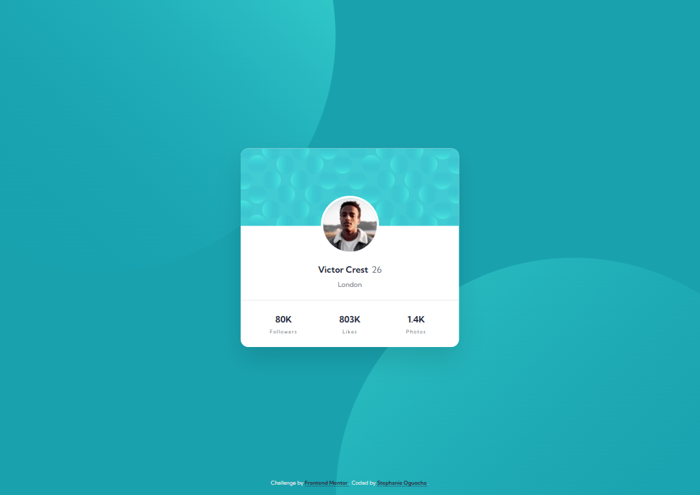
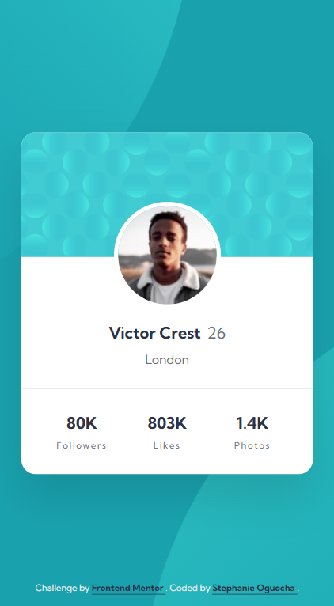

# Frontend Mentor - Profile Card Component Solution

This is my solution to the [Profile card component challenge on Frontend Mentor](https://www.frontendmentor.io/challenges/profile-card-component-cfArpWshJ). Frontend Mentor challenges help improve coding skills by building realistic projects from provided designs.

## Table of contents

- [Overview](#overview)
  - [The challenge](#the-challenge)
  - [Screenshot](#screenshot)
  - [Links](#links)
- [My process](#my-process)
  - [Built with](#built-with)
  - [What I learned](#what-i-learned)
  - [Continued development](#continued-development)
  - [Useful resources](#useful-resources)
  - [AI Collaboration](#ai-collaboration)
- [Author](#author)
- [Acknowledgments](#acknowledgments)

## Overview

### The challenge

The goal was to build a responsive profile card component that closely matches the desktop and mobile designs provided by Frontend Mentor.

The main requirements were to:

- Create a profile card with a header pattern, circular avatar, name, age, and location.
- Display profile statistics in three evenly spaced columns.
- Reproduce the decorative background patterns using the provided SVG assets.
- Ensure the layout adapts to different screen sizes.
- Use consistent colors, typography, spacing, and alignment.
- Include a footer attribution linking to Frontend Mentor.

### Screenshot

#### Desktop



#### Mobile




### Links

- Github repo URL: [Github repo URL](https://github.com/stephany247/profile-card-component-main)
- Live Site URL: [Deployed project URL](https://stephany247.github.io/profile-card-component-main/)

## My process

### Built with

- Semantic HTML5 markup
- CSS custom properties for consistent colors
- CSS Grid for layout and alignment
- Flexibility and responsive CSS techniques
- Absolute positioning for the overlapping profile avatar
- CSS pseudo-elements and background positioning
- SVG assets for decorative background patterns
- Google Fonts — Kumbh Sans
- Mobile-responsive design using CSS media queries
- Git and GitHub for version control

### What I learned

This project helped me improve my understanding of responsive layouts, CSS positioning, background patterns, and reusable design tokens.

**1. Using CSS custom properties**

I learned how CSS variables make it easier to maintain consistent colors and update a design without repeating color values throughout the stylesheet.

```css
:root {
  --blue-600: hsl(185, 75%, 39%);
  --navy-950: hsl(229, 23%, 23%);
  --gray-500: hsl(227, 10%, 46%);
  --gray-100: hsl(225, 10%, 92%);
  --white: hsl(0, 0%, 100%);
}
```

**2. Positioning an overlapping profile image**

I used absolute positioning and a horizontal transform to center the avatar over the boundary between the card header and the content area.

```css
.profile-avatar {
  position: absolute;
  top: 88px;
  left: 50%;
  transform: translateX(-50%);
  border: 5px solid var(--white);
  border-radius: 50%;
}
```

**3. Creating a responsive statistics section**

CSS Grid made it straightforward to distribute the statistics evenly across three columns.

```css
.profile-stats {
  display: grid;
  grid-template-columns: repeat(3, minmax(0, 1fr));
}
```

**4. Working with SVG background patterns**

I learned that using the original SVG assets provides a closer match to the supplied design than recreating complex decorative patterns with CSS gradients. I also practiced adjusting background positioning separately for desktop and mobile screens.

### Continued development

In future projects, I want to continue improving my skills in:

- Matching reference designs more precisely across different viewport sizes.
- Writing cleaner, more maintainable CSS.
- Improving accessibility through semantic HTML, readable contrast, and visible keyboard focus states.
- Understanding responsive background positioning and SVG scaling.
- Testing layouts at different screen widths and browser zoom levels.

### Useful resources

- [Frontend Mentor](https://www.frontendmentor.io/) — Provided the challenge and design reference for this project.
- [MDN Web Docs — CSS Grid](https://developer.mozilla.org/en-US/docs/Web/CSS/CSS_grid_layout) — Helped with understanding grid-based layouts.
- [MDN Web Docs — CSS Custom Properties](https://developer.mozilla.org/en-US/docs/Web/CSS/Guides/Cascading_variables/Using_custom_properties) — A useful reference for reusable CSS variables.
- [MDN Web Docs — Background Position](https://developer.mozilla.org/en-US/docs/Web/CSS/background-position) — Useful for positioning the decorative SVG patterns.
- [The Markdown Guide](https://www.markdownguide.org/) — Reference for formatting and organizing this README.

### AI Collaboration

I used ChatGPT as a development assistant during this project.

- **Debugging:** Identified inconsistent CSS variable names and helped resolve styling issues.
- **Responsive design:** Explored adjustments to the desktop and mobile layouts.
- **Styling:** Refined the profile card, decorative SVG backgrounds, and footer attribution.
- **Code review:** Reviewed CSS structure and suggested improvements to maintainability.
- **Documentation:** Helped organize the project README and document key learning points.

AI suggestions were reviewed and adapted to the project rather than being treated as a substitute for testing and understanding the code.

## Author

- Frontend Mentor - [@stephany247](https://www.frontendmentor.io/profile/stephany247)
- GitHub - [GitHub profile](https://github.com/stephany247)


## Acknowledgments

Thanks to [Frontend Mentor](https://www.frontendmentor.io/) for providing the design challenge and assets. The project was also an opportunity to practice responsive CSS, SVG backgrounds, and translating a visual reference into a working web page.